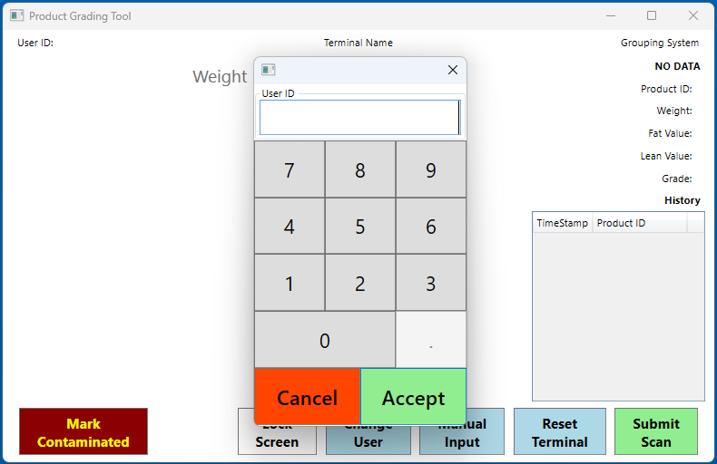

Project 5: Product Grading System | ViewTrak
=============================================

> Greetings!
>
> My name is Jonathan Hand. I have been a software developer for over 12 years
> working with various platforms and frameworks across numerous different
> industries.  In that time I have learned a lot, but in this career there is
> always more to learn.
>
> This project is a reflection on my capabilities. The below scenario was
> inspired by my first assignment received at ViewTrak back in 2014.  It was my
> first professional experience with building a project entirely from scratch.
> I had no previous knowledge of WPF or MVVM prior to working on it.  Up until
> that point I think the only experience I had was working with WinForms in VB6.
>
> Just as I did back then, this project is developed entirely from scratch
> using the latest technology.  Since I haven't really done any significant
> work with WPF since my time at ViewTrak, I've had to re-learn many of the
> concepts I learned before, such as how messaging and property notification
> works.  I've also architected it differently, using what I've learned about
> separation of concerns to deliver what I believe to be a proper demonstration
> of clean coding practices.
>
> If you have any questions or feedback about this project, feel free to reach
> out to me via email: jonathan.d.hand@outlook.com.


User Story
==========

Norman Nightingale of Nightingale's Goods & Services requires a system that
will allow his company to collect data in his livestock processing plant. The
data for each product needs to be collected at various stages throughout
processing.  At the end of the processing cycle for a single product, all of
the data must be printed on a label to be attached to the product at the end of
the processing line.

Data collection during the processing cycle is normally handled by more than
one employee. The solution needs to be accessible from multiple stations
throughout the facility.


Provisions
==========

Norman is supplying the "Custom Grading Tool" that provides Fat, Lean, and
Grade values.  The tool is compatible with a serial port only.  The device's
button activation will broadcast a 16-character string over the connection.
The exact positions of each value is located in the below example string.

```
Example: ########703255##
                     ^^   Grade
                   ^^     Lean Value
                 ^^       Fat Value
```

The other characters in the string can be discarded as its data is not relevant
to this project's requirements.


Solution
========

The Product Grading System is comprised of two main applications: A client
application for deployment on touch-based terminals running a Windows OS and
a server application that receives data from the terminals and consolidates it
into reports for administration.

**Technologies**
- WPF
- ASP.Net Core
- SQL Server


Development Setup
=================

Clone the source and run the project for an immediate demonstration.

```
git clone _reponame_ .
dotnet run --project ".\ProductGradingTool.WpfClient"
```

This will bring up the main window.


Instructions
============

Controls are locked until a user ID is entered first. You can input any number
you want to proceed.



*No external devices are supported at this time, so you will have to use the*
*provided controls to manually input values.*

Start by clicking "Manual Input" to scan in a product ID.  Product IDs are
normally printed either at this stage or a preceding stage before it.  Controls
will be enabled for data collection.

Once you have collected the desired data, press the "Save and Send" button
to save the data.  The data is saved locally and is then immediately uploaded
to the central server.

*The server project is currently under construction, so no data is sent yet.*

You can access any previous product scans in the history list.  When you select
a previous scan, it will bring up the committed data in the provided widgets.


Questions & Answers
===================

Q: Did you use AI to make this?

A: No. None of the code was generated by any AI agent. It was all written by
Hand (gettit?). That being said, I did utilize AI frequently for learning. It
was sometimes more useful than going to documentation and searching through an
article for the information I needed.

Q: Did you have any help with this project?

A: No. Not this time. However, back when I worked on the original project, I
received a lot of guidance from my superviser Chris Nightingale who was a great
ally and colleague at ViewTrak.

